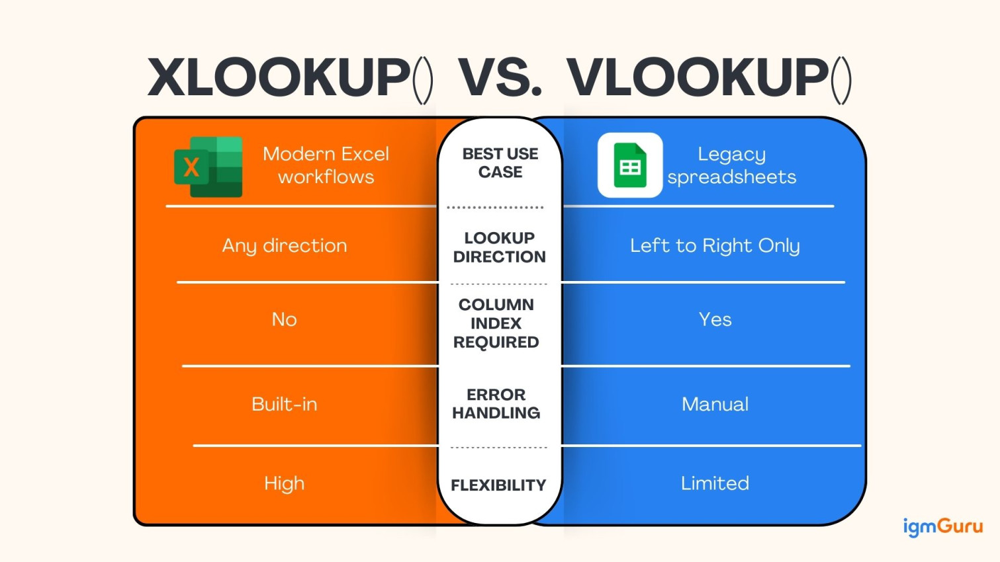
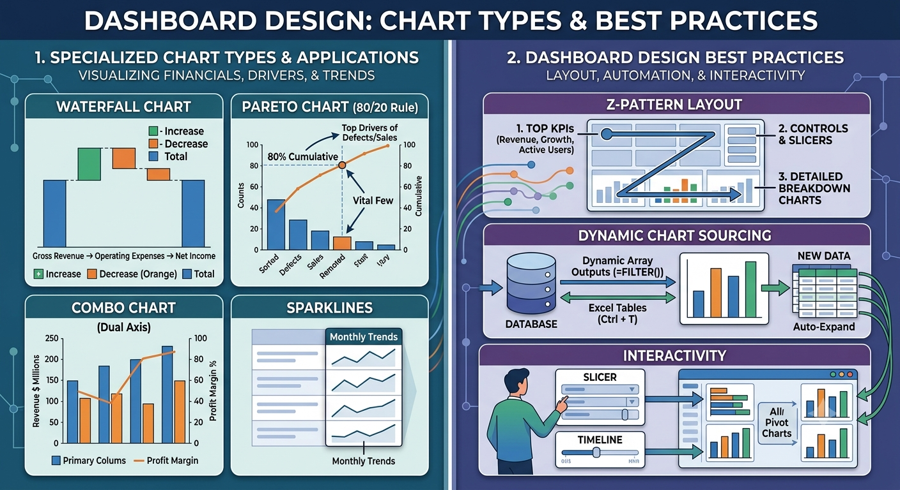

# Advanced Excel: Data Architecture, Analytics & Automation

## Overview
While basic spreadsheet skills focus on data entry and simple arithmetic, **Advanced Excel** involves building scalable data models, conducting sophisticated statistical analysis, and automating repetitive workflows. This module bridges the gap between simple data tracking and robust business intelligence, as utilized in professional data analyst roles.



---

## 1. Modern Data Lookup: The XLOOKUP Revolution
`XLOOKUP` is the powerful successor to `VLOOKUP` and `HLOOKUP`. It is more resilient because it does not require a specific column index number and can look up data both to the left and right of the search key.

**Syntax:** `=XLOOKUP(lookup_value, lookup_array, return_array, [if_not_found], [match_mode])`

### Example 1: Basic Vertical Lookup (Left-to-Right)
Find the "Sales Amount" for a specific "Order ID."
```excel
// Table: Orders (Cols A to C: OrderID, Customer, Sales)
=XLOOKUP("ORD-101", A2:A500, C2:C500)
// Result: Searches for "ORD-101" in Column A and returns the corresponding value from Column C.
```

### Example 2: Resilience (Right-to-Left Lookup)
Unlike `VLOOKUP`, `XLOOKUP` can return data located to the left of the lookup column.
```excel
// Find the "Customer Name" based on a "Phone Number" located in a column further to the right.
=XLOOKUP("999-000-111", D2:D500, B2:B500)
```

### Example 3: Handling Missing Data
Automatically handle errors without using an external `IFERROR` function.
```excel
=XLOOKUP("ORD-999", A2:A500, C2:C500, "Order Not Found")
```

---

## 2. Advanced Pivot Table Techniques
To move beyond basic summaries, an advanced analyst uses:
* **Calculated Fields:** Creating new data metrics inside the Pivot Table (e.g., `Profit = Revenue - Cost`).
* **Slicers & Timelines:** Creating interactive dashboards that allow users to filter data visually with a single click.
* **GETPIVOTDATA:** A function used to extract specific data points from a pivot table into a custom report layout while maintaining data integrity even if the pivot table layout changes.

---

## 3. Analytical Modeling & "What-If" Analysis
Professional modeling requires testing different business scenarios:
* **Goal Seek:** Used when you know the desired result of a formula but need to find the input value required to achieve it (e.g., "What sales volume do I need to reach a 20% profit margin?").
* **Solver:** An optimization tool used to find the best way to allocate resources (e.g., minimizing costs while meeting production targets).
* **Data Tables:** Visualising how changing one or two variables affects a specific outcome (e.g., how different interest rates and loan terms affect a monthly payment).

---

## 4. Automation: Power Query & Macros
* **Power Query (M Language):** The industry standard for ETL (Extract, Transform, Load). It allows you to connect to external databases, clean millions of rows, and automate the cleaning steps so that a simple "Refresh" processes new data automatically.
* **VBA (Macros):** Using Visual Basic for Applications to automate repetitive manual tasks, such as generating monthly PDF reports or custom user forms.

---

## 5. Statistical Analysis & Data Analysis ToolPak
Excel is widely used for business forecasting and hypothesis testing. Enable via `File > Options > Add-Ins > Excel Add-ins > Analysis ToolPak`.

### Key Analytical Techniques
* **Descriptive Statistics:** Generates a one-click summary report including Mean, Standard Error, Median, Mode, Standard Deviation, Sample Variance, Kurtosis, Skewness, Range, Minimum, and Maximum.
* **Correlation Matrix:** Evaluates linear relationships between multiple numeric variables simultaneously to identify multicollinearity before building predictive models.
* **Linear Regression Output:**
  * **$R^2$ (Coefficient of Determination):** Explains how much variance in the dependent variable ($Y$) is explained by independent variables ($X$).
  * **$P$-Value:** Values below `0.05` indicate statistical significance of predictor variables.
  * **Coefficients:** Used to construct the regression line equation: $Y = \beta_0 + \beta_1 X_1 + \epsilon$.

---

## 6. Advanced Visual Analytics & Dashboard Architecture
A professional dashboard turns raw data into an executive decision-making tool.


### Specialized Chart Types & Applications
* **Waterfall Chart:** Visualizes financial cumulative impact (e.g., Gross Revenue $\rightarrow$ Operating Expenses $\rightarrow$ Net Income).
* **Pareto Chart (80/20 Rule):** Combines sorted bar chart (counts) with a cumulative total line chart to highlight top drivers of defects or sales.
* **Combo Chart (Dual Axis):** Displays two different scale metrics simultaneously (e.g., Revenue in $ Millions as Clustered Columns vs. Profit Margin % as a Line on a Secondary Axis).
* **Sparklines (`Insert > Sparklines`):** Micro-charts contained entirely within a single cell, perfect for inline table trend tracking across months.

### Dashboard Design Best Practices for Analysts
1. **Z-Pattern Layout:** Place top-level executive KPIs (Total Revenue, YoY Growth, Active Users) across the top header, followed by detailed broken-down charts below.
2. **Dynamic Chart Sourcing:** Never hardcode chart data ranges. Base charts on **Excel Tables (`Ctrl + T`)** or dynamic dynamic array outputs (`=FILTER()`) so visualizers auto-expand when new data arrives.
3. **Interactivity:** Connect visual Slicers and Timelines across multiple Pivot Charts simultaneously using `PivotChart Analyze > Filter Connections`.

---

## 7. Troubleshooting & Error Handling
In professional modeling, formulas can fail when inputs change or data pipelines break. Understanding native error codes and wrap-around functions ensures data architecture remains resilient.

### Common Formula Error Types

| Error | Root Cause | Example Scenario | Resolution Strategy |
| :--- | :--- | :--- | :--- |
| **`#N/A`** | **Value Not Available:** The lookup function cannot locate the search key in the source range. | `=XLOOKUP("ID-99", A2:A10, B2:B10)` where `"ID-99"` does not exist. | Pass default fallback text inside `XLOOKUP`'s `[if_not_found]` argument, or wrap legacy lookups in `IFNA()`. |
| **`#VALUE!`** | **Data Type Mismatch:** Mathematical operations attempted on incompatible types (e.g., text instead of numbers). | `="100" + "Ten"` or passing text into financial/math functions expecting numeric arguments. | Clean data using `VALUE()`, `TRIM()`, or clean text characters before calculation. |
| **`#REF!`** | **Invalid Cell Reference:** Formula points to a cell, column, or row that was deleted or overwritten. | `=A2 + B2` where Column `B` is subsequently deleted from the sheet. | Audit dependencies using **Trace Precedents** (`Alt + M + P`) before deleting rows/columns. Undo deletion immediately. |
| **`#DIV/0!`** | **Division by Zero:** Calculation attempts to divide a number by zero or an empty cell. | `=Sales / Units_Sold` when `Units_Sold` contains `0` or blank values. | Guard formula with conditional checks: `=IF(Units_Sold=0, 0, Sales/Units_Sold)`. |
| **`#NAME?`** | **Unrecognized Text:** Formula syntax contains a misspelled function name or undefined named range. | `=XLOKUP(...)` or referencing a Named Range before defining it. | Double-check spelling against auto-complete prompts or inspect the **Name Manager** (`Ctrl + F3`). |
| **`#NUM!`** | **Numeric Error:** Calculation yields a value that exceeds valid limits or violates math rules. | `=SQRT(-16)` or `=10^309` (exceeds Excel's floating-point cap of $\approx 1.79 \times 10^{308}$). | Adjust parameters to fall within mathematical boundaries and valid iteration limits. |
| **`#SPILL!`** | **Blocked Dynamic Array:** A dynamic array formula (e.g., `SORT`, `FILTER`, `UNIQUE`) cannot expand because content blocks its output grid. | `=FILTER(A2:A100, B2:B100>10)` placed above non-empty cells. | Clear all data from the range highlighted by the dotted indicator box. |
| **`#NULL!`** | **Intersection Error:** Attempted to find the intersection of two ranges that do not intersect (often caused by a missing comma). | `=SUM(A1:A10 B1:B10)` (uses a space instead of a comma operator). | Insert proper union operators (commas) or range operators (colons) within function arguments. |

### Error Defense Strategies
* **`IFERROR(value, value_if_error)`:** Catches **all** error types and replaces them with a fallback value. *Use cautiously*, as it can mask structural bugs like `#REF!`.
* **`IFNA(value, value_if_na)`:** Specifically handles `#N/A` errors from lookup functions while allowing critical structural errors (`#VALUE!`, `#REF!`) to surface for debugging.

---

**Next Step:** After mastering Excel modeling and XLOOKUP, let's transition to collaborative cloud tracking in [Google Sheets](01.01.06-Google_Sheets.md).
**Skill Polished**: Advanced Excel, Data Modeling, Pivot Tables
**Status:** Completed ✅