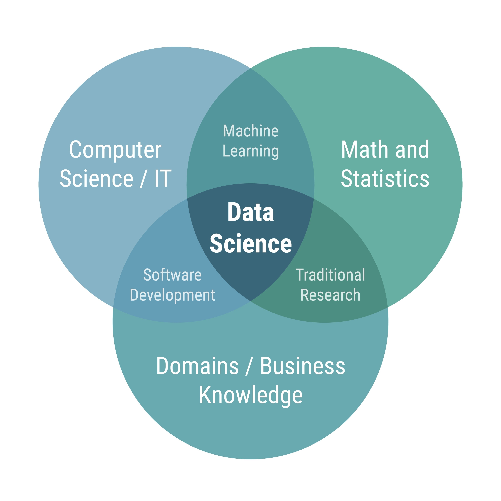

# What is Data Science & Its Importance



## 1. Introduction to Data Science
Welcome to the foundational overview of Data Science. Before diving into programming languages like Python or databases like MySQL, it is crucial to understand the high-level landscape of this field.

### The Formal Definition
At its core, **Data Science** is an interdisciplinary field of study that uses a combination of mathematics, applied statistics, computer programming, and domain (business) knowledge to extract meaningful insights, patterns, and knowledge from large volumes of data.

### The Simple Definition
In practical terms, Data Science is the end-to-end process of **collecting, cleaning, analysing, and interpreting data** to make informed, actionable business decisions.

---

## 2. Why is Data Science Important?
In today's digital world, data is generated constantly—from online shopping habits and social media interactions to sensors in smart devices and supply chain logistics. Companies and organizations use this data to:

1. **Make Better Decisions:** Transitioning from "gut-feeling" leadership to *Data-Driven Decision Making* (DDDM). For example, deciding which product feature to launch next based on user engagement metrics.
2. **Predict Outcomes:** Utilizing historical data to forecast future trends (e.g., weather forecasting, stock market predictions, or predicting customer churn).
3. **Automate Processes:** Building systems that learn and adapt without manual intervention (e.g., recommendation engines like Netflix or YouTube).
4. **Identify Inefficiencies:** Pinpointing bottlenecks in logistics or operational workflows to save time and reduce costs.

---

## 3. The Core Pillars of Data Science
A successful data professional sits at the intersection of three main domains:

1. **Computer Science / IT Skills:** The ability to write code (Python), query databases (SQL), manage versions (Git), and scale applications.
2. **Math & Statistics:** The ability to understand probability, linear algebra, calculus, and statistical significance to ensure that findings are mathematically valid and not just random noise.
3. **Domain / Business Knowledge:** The ability to understand the specific industry you are working in (Finance, Healthcare, E-commerce). Without business context, even the best mathematical models are useless.

### Why is Visualisation not included?

Now, you may be wondering why **Visualisation** is not listed as one of the core pillars. The reason is that while it isn't a foundational knowledge domain itself, it acts as the essential **delivery system** for the others.

This does not mean that Visualisation is unnecessary in Data Science or Data Analytics; rather, it is the medium through which the pillars are applied. If the three pillars are the engine, fuel, and wheels of a car, **Visualisation is the dashboard and steering wheel.** Without it, you’re just a genius sitting in a fast car who can't see where they’re going or tell anyone how fast they're moving.

---

## 4. Roles in the Data Ecosystem
While the term "Data Scientist" is often used as a catch-all, the industry actually divides the workload into specific roles. Understanding these will help you tailor your resume and skills:

* **Data Analyst:** Focuses on processing and performing statistical analysis on existing datasets. They create Visualisations (Tableau/Power BI) and dashboards to help businesses understand *what happened* and *why it happened*. 
* **Data Engineer:** The architects. They build and maintain the massive data pipelines and database architectures (ETL - Extract, Transform, Load) that allow Analysts and Scientists to access clean data.
* **Data Scientist:** Focuses on advanced predictive modeling and machine learning. They ask *what will happen next* and build the algorithms to predict it.
* **Machine Learning Engineer:** Focuses on taking the predictive models built by Data Scientists and deploying them into production environments so they can run at scale (e.g., integrating a recommendation model into a live web app).

---

## 5. Methodologies for Data Science Projects
Data Science projects require structure to move from raw data to actionable insights. While there are many ways to manage these projects, here are the most common methodologies used in the industry.

### The Waterfall Methodology
Waterfall is a **linear, sequential approach**. You must complete one phase fully before moving on to the next.
- **How it works:** Requirements $\rightarrow$ Analysis $\rightarrow$ Design $\rightarrow$ Implementation $\rightarrow$ Testing $\rightarrow$ Maintenance.
- **Example:** A bank building a regulatory compliance reporting tool where requirements are strictly defined by law and cannot change mid-process.
- **Best for:** Projects with fixed requirements, clear timelines, and low uncertainty.
![[../Images/waterfall.jpg]]

### The Agile Methodology
Agile is an **iterative and incremental approach**. Instead of one massive launch, the project is broken into small, manageable "sprints" (usually 2–4 weeks).
- **How it works:** Continuous planning, learning, and improvement. You deliver a "Minimum Viable Product" (MVP) early and refine it based on feedback. 
- **Example:** A Data Scientist developing a personalized recommendation engine for an e-commerce site, releasing a basic version first and improving its accuracy based on user click-through rates.
- **Best for:** Projects where requirements evolve as you learn more from the data.

### CRISP-DM (Cross-Industry Standard Process for Data Mining)

This is the **industry standard** specifically designed for Data Science. It bridges the gap between technical work and business goals.
1. **Business Understanding:** Define the objective. 
2. **Data Understanding:** Explore and inspect the data.
3. **Data Preparation:** Clean and format the data.
4. **Modeling:** Apply machine learning algorithms.
5. **Evaluation:** Check if the model meets business goals.
6. **Deployment:** Put the model into production.

---

## 6. Google Data Analytics Framework: DDDM
A key concept from the Google Data Analytics curriculum is **Data-Driven Decision Making (DDDM)**. 

DDDM is the practice of using facts, metrics, and data to guide strategic business decisions that align with your goals, objectives, and initiatives. 

When you start a project, you don't just write code immediately. You follow a structured mental model:
1. **Identify the Business Task:** What problem are we actually trying to solve?
2. **Define the Metrics:** How will we measure success?
3. **Locate the Data:** Where is the data stored? Is it in a MySQL database, an Excel spreadsheet, or a JSON file?

### A Quick Look Ahead (Python Example)
Even though we are just talking about concepts, this is how quickly we will turn raw data into insights later in this curriculum using Python:

```python
# A conceptual preview of Data Science in Python
import pandas as pd

# 1. Collect Data
data = {'Product': ['A', 'B', 'C'], 'Sales': [150, 200, 50]}
df = pd.DataFrame(data)

# 2. Analyse Data (Find the top-selling product)
top_product = df.loc[df['Sales'].idxmax()]

# 3. Interpret & Decide
print(f"We should invest more marketing into Product {top_product['Product']}!")
```

---

**Next Step:** After formalizing the data science lifecycle, let's install the professional tools required to execute it in [Anaconda and Conda Workflow](01.03.02-Anaconda_and_Conda_Workflow.md).
**Skill Unlocked**: Data-Driven Decision Making (DDDM)
**Status:** Completed ✅