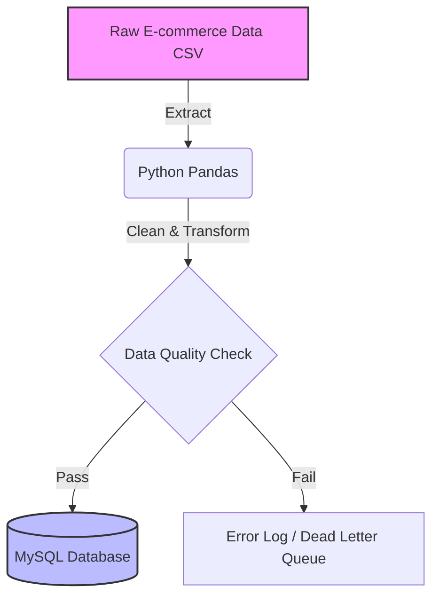
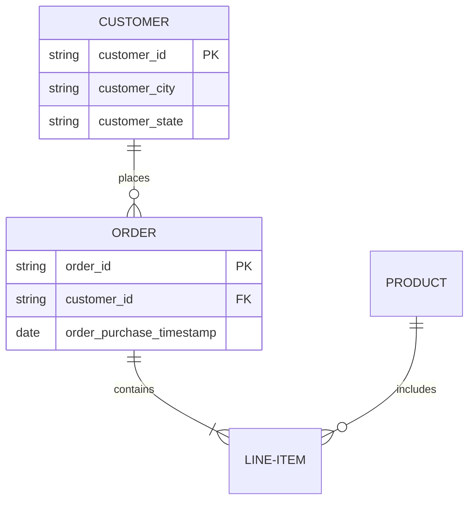

# 01.06.03 - Advanced Syntax: Math Formulas and Mermaid Diagrams

Standard Markdown is excellent for text, but as a Data Professional, you frequently need to document mathematical models, statistical formulas, and data architectures. This module covers how to embed LaTeX for mathematics and Mermaid.js for visualising ETL pipelines and database schemas directly within your notes and repositories.

---

## 1. Mathematical Formulas with LaTeX

Whether you are writing notes on machine learning algorithms in Obsidian or documenting the statistical tests used in a Jupyter notebook, LaTeX allows you to render beautifully formatted mathematics directly from plain text.

### Inline vs. Block Equations
* **Inline Mathematics:** Wrap the formula in single dollar signs (`$`). For example, calculating the population mean $\mu = \frac{\sum x}{N}$ flows naturally within a sentence without breaking the paragraph structure.
* **Block Mathematics:** Wrap the formula in double dollar signs (`$$`) to center it on its own line. This is ideal for core algorithms or complex statistical models.

### Common Data Science Examples

**Linear Regression Equation:**
When documenting predictive models for portfolio projects, clearly stating the mathematical foundation adds professional rigor.
$$y = \beta_0 + \beta_1 x_1 + \beta_2 x_2 + ... + \epsilon$$

**TF-IDF (Term Frequency-Inverse Document Frequency):**
Essential for documenting Applied NLP modules and text vectorization.
$$\text{TF-IDF}(t,d) = \text{TF}(t,d) \times \log\left(\frac{N}{\text{DF}(t)}\right)$$

**Standard Deviation:**
$$\sigma = \sqrt{\frac{\sum (x_i - \mu)^2}{N}}$$

---

## 2. Visualising Architecture with Mermaid.js

Mermaid.js is a powerful JavaScript-based diagramming tool that uses markdown-inspired text definitions to generate charts and diagrams dynamically. It is the industry standard for keeping architecture diagrams version-controlled alongside your code.

To create a Mermaid diagram, you use a standard code block but specify `mermaid` as the language.

### Flowcharts: Documenting ETL Pipelines
Data pipelines (Extract, Transform, Load) are best explained visually. Using a simple flowchart ensures stakeholders understand how data moves from raw files to the final database.

### Entity-Relationship Diagrams (ERD)
When designing relational databases or joining tables for a dashboard, ERDs are essential for showing how entities connect. 

---

## 3. Best Practices for Your Knowledge Base

1.  **Obsidian Integration:** Obsidian natively renders both LaTeX math and Mermaid diagrams out of the box. Utilise this to build a highly visual "second brain" that seamlessly connects your SQL queries, Python scripts, and statistical theory.
2.  **VS Code & GitHub Repositories:** GitHub READMEs natively support Mermaid, making it incredibly easy to document your portfolio pipelines directly on your profile. In VS Code, you can use extensions like "Markdown Preview Mermaid Support" to view your diagrams live as you type.
3.  **Keep the Raw Text Readable:** While LaTeX can become visually complex, format your block equations with spaces and line breaks in the raw text so that it remains easily readable even if a preview pane is not available.

---

**Next Step:** After integrating ERDs and formulas, let's apply these directly to our project repositories in [Effective Documentation in VS Code and Jupyter](01.06.04-Effective_Documentation_in_VS_Code_and_Jupyter.md).
**Skill Unlocked**: Mermaid.js, LaTeX, Architecture Diagramming
**Status:** Completed ✅