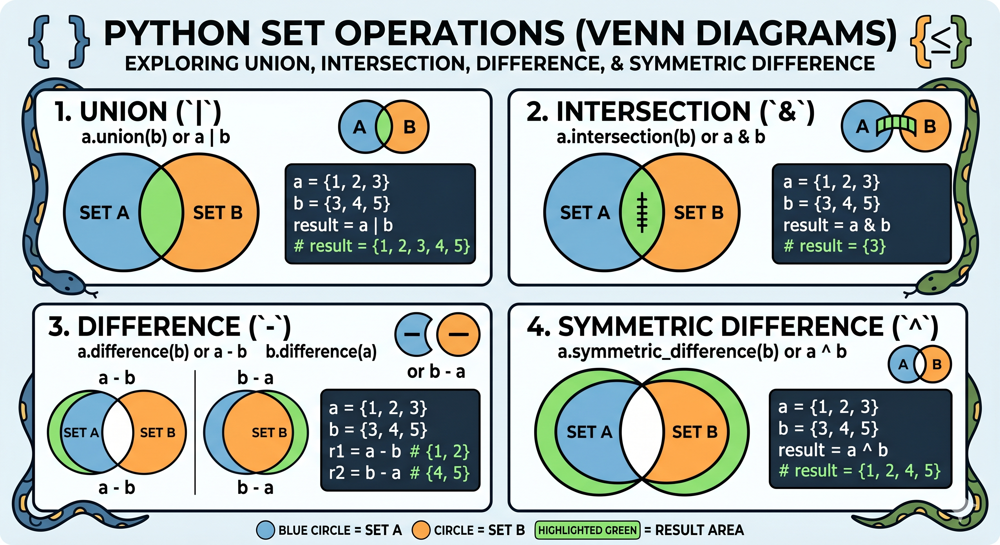

# Dictionaries & Sets: Properties & Operations

## Overview
In Python, **Dictionaries** and **Sets** are built-in data structures used to store collections of data. While lists and tuples are indexed by a range of numbers, **dictionaries are indexed by "keys"**, and **sets are unindexed collections of unique elements**. Understanding these is crucial for data manipulation and fast lookups.

---

## 1. Dictionaries in Python
A dictionary is a collection of key-value pairs. It is used to map or associate things you want to store (values) to keys you need to get them.

### Properties of a Dictionary
1. **Unordered:** The items in a dictionary have no defined order (though from Python 3.7 onwards, they maintain insertion order).
2. **Mutable:** You can change, add, or remove items after the dictionary is created.
3. **Indexed:** Values are accessed using their corresponding keys.
4. **No Duplicate Keys:** A dictionary cannot have two items with the same key. If a duplicate key is assigned, the last assigned value overwrites the previous one.
5. **Hashability Requirement:** Keys _must_ be of an immutable (hashable) data type, such as strings, numbers, or tuples containing only immutable objects. Values can be of any data type.

### Creating and Accessing Dictionaries
```python
a = {}         # Creating an empty dictionary.
b = {"a": 20}  # Creating a dictionary with a single key-value pair.

# Creating a dictionary with multiple key-value pairs.
student = {
    "name": "Animesh",
    "course": "Data Analytics",
    "marks": [92, 85, 88],
    "is_certified": True
}

# Accessing elements
print(student["name"])      # Output: Animesh
print(student["marks"][0])  # Output: 92
# print(student["score"]) # ERROR: This raises a KeyError because "score" doesn't exist! 
print(student.get("score")) # Output: None (Safe way to handle missing keys)

# Adding or changing - values and keys
student["age"] = 29              # Adds a new key-value pair
student["course"] = "Data Sci"   # Updates the value of existing key

# Single key renaming
student["first_name"] = student.pop("name")

# Bulk key Renaming
mapping = {"first_name": "NAME", "course": "COURSE", "marks": "MARKS"}
for old_key, new_key in mapping.items():
    if old_key in student:
        student[new_key] = student.pop(old_key)
```

### Important Dictionary Methods
Here are the most frequently used methods for dictionary manipulation:

```python
my_dict = {"a": 1, "b": 2, "c": 3}

# 1. items(): Returns a view object of (key, value) tuples
print(my_dict.items())  # dict_items([('a', 1), ('b', 2), ('c', 3)])

# 2. keys(): Returns a view object of all keys
print(my_dict.keys())   # dict_keys(['a', 'b', 'c'])

# 3. values(): Returns a view object of all values
print(my_dict.values()) # dict_values([1, 2, 3])

# 4. update(): Updates the dictionary with supplied key-value pairs
my_dict.update({"c": 4, "d": 5}) 
print(my_dict)          # {'a': 1, 'b': 2, 'c': 4, 'd': 5}

# 5. setdefault(): Adds a key only if it does not already exist. If the key is already there, it returns the existing value and does nothing.
my_dict.setdefault("d", 6)
print(my_dict)          # {'a': 1, 'b': 2, 'c': 4, 'd': 5}

# 6. get(): Returns the value of the specified key
print(my_dict.get("a")) # Output: 1
print(my_dict.get("z")) # Output: None (Does not throw an error)
# print(my_dict["z"])   # This would throw a KeyError!

# 7. pop(): Removes the element with the specified key and returns its value
val = my_dict.pop("b")
print(val)              # Output: 2

# 8. popitem(): Removes and returns the last inserted key-value pair as a tuple
val = my_dict.popitem()
print(val)              # Output: ('d', 5)

# 9. clear(): Removes all elements from the dictionary, leaving it empty
my_dict.clear()
print(my_dict)          # Output: {}
```

#### Deep Dive: Dictionary Views are Dynamic
Methods like `.keys()`, `.values()`, and `.items()` do not return static lists; they return **view objects**. If the dictionary changes, the view object updates automatically in real-time.
```python
# Advanced Creation 1: dict.fromkeys()
keys = ['name', 'age', 'role']
user_dict = dict.fromkeys(keys, 'unknown')
print(user_dict)  # Output: {'name': 'unknown', 'age': 'unknown', 'role': 'unknown'}

# Advanced Creation 2: zip() pairing
keys = ['name', 'age', 'role']
values = ['Animesh', '29', 'DA']
user_dict = dict(zip(keys, values))
print(user_dict)  # Output: {'name': 'Animesh', 'age': '29', 'role': 'DA'}
```

#### Dictionary Comprehensions
Just like list comprehensions, you can generate dictionaries elegantly in a single line.
```Python
# Create a dictionary of numbers and their squares
squares = {x: x**2 for x in range(1, 6)}
print(squares)  # Output: {1: 1, 2: 4, 3: 9, 4: 16, 5: 25}
```

---

## 2. Sets in Python
A Set is a collection of non-repetitive (unique) elements. Sets are written with curly brackets `{}`, similar to dictionaries, but without key-value pairs.

### Properties of a Set
1. **Unordered:** Sets are unindexed, meaning you cannot access elements using `[0]` or `[1]`.
2. **Unchangeable (Immutable elements):** You cannot change the items in a set once created, though you can *add* or *remove* items from the set itself.
3. **No Duplicates Allowed:** Sets cannot contain duplicate values. If you try to add a duplicate, it will simply be ignored.
4. **No Mutable Elements inside:** You cannot put lists or dictionaries inside a set because they are mutable (unhashable).

### Creating Sets
```python
# Creating a basic set
my_set = {1, 2, 3, 4, 5, 1, 2} 
print(my_set)  # Output: {1, 2, 3, 4, 5} (Duplicates are automatically removed)

# Creating an empty set
# Note: empty_set = {} creates an empty DICTIONARY, not a set.
empty_set = set() 
print(type(empty_set))  # Output: <class 'set'>
```

### Standard Modification Methods
```python
s = set()

# 1. add(): Adds an element to the set
s.add(4)         # Updated set: {4}
s.add('ab')      # Updated set: {4, 'ab'}
# s.add([1, 2])  # Throws an error: unhashable type: 'list'

# 2. remove(): Removes an element. Throws KeyError if not found.
s.remove(4)

# 3. pop(): Removes and returns an arbitrary element (unpredictable due to order)
val = s.pop()

# 4. clear(): Empties the set
s.clear()        # Set is now: set()
```

```python
# 5. update(iterable): Adds multiple items from another set or any iterable (list, tuple, etc)
set1 = {1, 2}
set2 = {2, 3}
my_list = [3, 4]
my_tuple = (4, 5)
set3 = {5, 6}

# Updating with Another Set: (most commonly used)
set1.update(set2)
print(set1)  # Output: {1, 2, 3}

# Updating with Multiple Iterables: (lists, tuples, strings)
# Here Python treats a string as an iterable of individual characters
set1.update(my_list, my_tuple, "ab", ["ab"])
print(set1)  # Output: {1, 2, 3, 4, 5, 'a', 'b', 'ab'} (order will vary)
```

```python
# 6. discard(element): Removes the specified element if present; does not raise an error if it is missing.
# Initializing a set
fruits = {"apple", "banana", "cherry"}

# 1. Removing an existing item
fruits.discard("banana")
print(fruits)  # Output: {'apple', 'cherry'}

# 2. Attempting to remove an item that is NOT in the set
fruits.discard("orange") 
print(fruits)  # Output: {'apple', 'cherry'} (No error is raised)
```

### Relational & Evaluation Methods
These methods evaluate structural relationships between two or more sets.
```Python
sup = {1, 2, 3, 5}
sub = {1, 2, 3}
alt = {7, 8}

# 1. issubset(): Checks if all elements of this set are inside the target set
print(sub.issubset(sup))    # Output: True

# 2. issuperset(): Checks if this set contains all elements of the target set
print(sup.issuperset(sub))  # Output: True

# 3. isdisjoint(): Checks if two sets have absolutely zero elements in common
print(sub.isdisjoint(alt))  # Output: True (no overlapping elements)
```

Using comparison operators behaves as a shorthand for these evaluations, provided **both sides are sets**:
```Python
set_a = {1, 2}
set_b = {1, 2, 3}

# This works perfectly:
print(set_a <= set_b) # True (subset shorthand)
print(set_b >= set_a) # True (superset shorthand)

# This will raise a TypeError:
# print(set_a <= [1, 2, 3])
```

If you are working with lists and don't want to convert them to sets (perhaps to preserve duplicates or order), you can use `all()` in a list comprehension:
```Python
list_a = [1, 2, 2]
list_b = [1, 2, 3, 4]

# Check if all elements of list_a are in list_b
is_subset = all(item in list_b for item in list_a)
print(is_subset)  # Returns: True
```

### Mathematical Operations
Sets are highly optimized for mathematical operations like finding intersections, unions, and differences (conceptually similar to Venn Diagrams).
These operations are incredibly useful for data cleaning and comparison (e.g., finding overlapping users in two different database tables).



| Method                     | Operator | Description                                            |
| -------------------------- | -------- | ------------------------------------------------------ |
| **`union`**                | `\|`     | Returns: all unique items present in all sets.         |
| **`intersection`**         | `&`      | Returns: common items present in all sets.             |
| **`difference`**           | `-`      | Returns: items in the first set but not in the others. |
| **`symmetric_difference`** | `^`      | Returns: items present in either set, but not both.    |

```python
set_A = {1, 2, 3, 4}
set_B = {3, 4, 5, 6}

# 1. Union (Elements in either A or B)
# Formula: A U B
print(set_A.union(set_B))  # OR
print(set_A | set_B)
# Output: {1, 2, 3, 4, 5, 6}

# 2. Intersection (Elements common to both A and B)
# Formula: A ∩ B
print(set_A.intersection(set_B))  # OR
print(set_A & set_B)
# Output: {3, 4}

# 3. Difference (Elements in A but NOT in B)
# Formula: A - B
print(set_A.difference(set_B))  # OR
print(set_A - set_B)
# Output: {1, 2}

# 4. Symmetric Difference (Elements in either A or B, but NOT both)
# Formula: A Δ B
print(set_A.symmetric_difference(set_B))  # OR
print(set_A ^ set_B)
# Output: {1, 2, 5, 6}
```

### Set Comprehensions
Like lists and dictionaries, sets can be built dynamically on a single line while dropping duplicate values implicitly.
```Python
# Find unique lengths of words in a list
words = ["apple", "pear", "banana", "kiwi", "apple"]
word_lengths = {len(w) for w in words}
print(word_lengths)  # Output: {4, 5, 6} (Duplicates merged)
```

---

## 3. Performance & Time Complexity Summary
Why use Dictionaries and Sets instead of Lists? It comes down to performance lookup speeds. Dictionaries and Sets utilize an underlying data structure called a **Hash Table**.

**Analogy:** Searching a list is like walking down a shelf looking at every book one by one until you find the right title. Searching a dictionary or set is like using an index code that instantly teleports you directly to the exact shelf slot where the book is resting.

---

**Next Step:** After mapping relational data, let's bundle logic into highly reusable [Functions and Recursion](02.01.08-Functions_Variable_Scope_Docstrings_and_Recursion.md).
**Skill Unlocked**: Data Mapping, Unique Sets
**Status:** Completed ✅