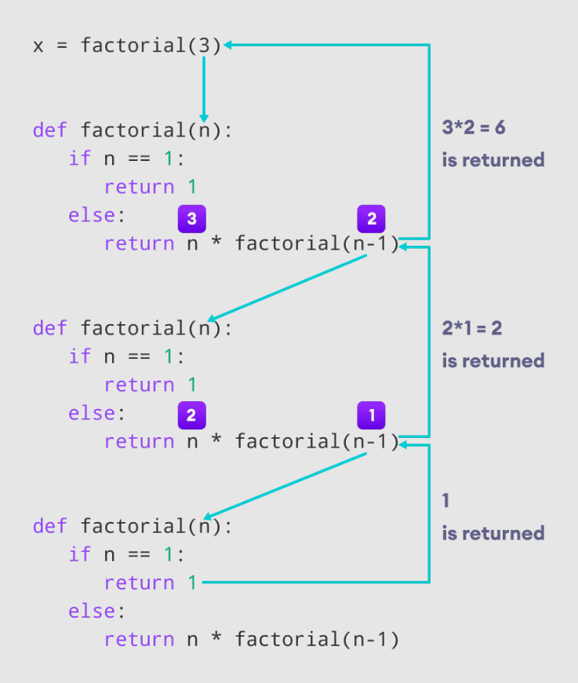
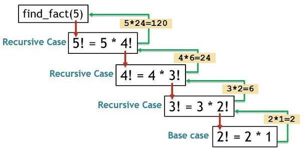

# Functions & Recursion in Python

## Overview
As you build more complex programs, writing the same logic repeatedly becomes inefficient. **Functions** are reusable blocks of code that perform a specific task. They help in organizing code, making it readable, and adhering to the DRY (Don't Repeat Yourself) principle. **Recursion** is an advanced functional concept where a function calls itself to solve smaller instances of the same problem.

---

## 1. Introduction to Functions
A function is a group of related statements that performs a specific task. It only runs when it is called. You can pass data, known as parameters, into a function. A function can return data as a result.
For a full alphabetical list of Python 3.13's 71 built-in functions, see the [official Python documentation](https://docs.python.org/3/library/functions.html). You can also check out this [Python file](Learning_path_fully_optimised/99.99-Shared_Utilities/python_functions.py), which explains their use cases and syntax.

### Built-in vs. User-Defined Functions
* **Built-in Functions:** Provided by Python natively (e.g., `len()`, `print()`, `range()`, `type()`).
* **User-Defined Functions:** Created by the programmer to perform specific tasks.

---

## 2. Defining and Calling a Function
In Python, a function is defined using the `def` keyword, followed by the function name, parentheses `()`, and a colon `:`. The code block within every function starts with an indentation.

```python
# Defining a function
def greet_user():
    print("Hello! Welcome to Data Analytics.")

# Calling the function
greet_user()
```

---

## 3. Arguments and Parameters
Information can be passed into functions as arguments. 
* **Parameter:** The variable listed inside the parentheses in the function definition.
* **Argument:** The actual value that is sent to the function when it is called.

### Positional vs. Keyword Arguments
```python
def introduce(name, role):
    print(f"My name is {name} and I am a {role}.")

# Positional Arguments (Order matters)
introduce("Animesh", "Data Analyst")

# Keyword Arguments (Order doesn't matter)
introduce(role="Data Scientist", name="Rohan")
```

### Default Parameters
You can assign a default value to a parameter. If the function is called without an argument, it uses the default value.

```python
def greet(name="Guest"):
    print(f"Hello, {name}!")

greet("Animesh")  # Output: Hello, Animesh!
greet()           # Output: Hello, Guest!
```

---

## 4. Variable Length Arguments (*args and **kwargs)

Sometimes in data analytics, you don't know in advance how many arguments a function might need to accept. `*args` and `**kwargs` are special syntaxes in Python function definitions that allow you to pass a variable number of arguments dynamically. 

### `*args` (Positional Arguments)
`*args` allows you to pass a variable number of positional arguments. It collects any extra positional arguments passed to a function into a **tuple**. The name `args` is just a convention; you could use any valid variable name preceded by a single asterisk (e.g., `*datasets`, `*columns`).

``` python
# Data Analytics Example: Passing multiple files to process
def merge_datasets(*args):
    print(f"Data type of args: {type(args)}") # <class 'tuple'>
    print(f"Received {len(args)} datasets to merge.")
    
    for i, dataset in enumerate(args):
        print(f"Processing dataset {i+1}: {dataset}")
 
# Passing 3 arguments
merge_datasets("sales_Q1.csv", "sales_Q2.csv", "sales_Q3.csv")

# Passing 0 arguments
merge_datasets()  # No output (empty tuple)
```

### `**kwargs` (Keyword Arguments)
`**kwargs` allows you to pass a variable number of keyword arguments. It collects any extra keyword arguments passed to a function into a **dictionary**. Again, `kwargs` is the conventional name, but you could use `**config` or `**options`.

``` python
# Data Analytics Example: Passing dynamic configuration parameters
def connect_to_database(**kwargs):
    print(f"Data type of kwargs: {type(kwargs)}") # <class 'dict'>
    
    print("Initializing database connection with config:")
    for key, value in kwargs.items():
        print(f"- {key.upper()}: {value}")
 
connect_to_database(host="localhost", user="root", db_name="healthcare_db", port=3306)
# Output:
# - HOST: localhost
# - USER: root
# - DB_NAME: healthcare_db
# - PORT: 3306
```

### Combining `*args` and `**kwargs`
You can use both in the same function definition. **The order is strictly enforced:** Standard parameters -> `*args` -> Default/Keyword parameters -> `**kwargs`.

``` python
# Data Analytics Example: Dynamic SQL Query Builder
def build_sql_query(table_name, *columns, limit=100, **filters):
    print(f"Table: {table_name}")
    print(f"Columns to extract (*args): {columns}")
    print(f"Row Limit: {limit}")
    print(f"Filter Conditions (**kwargs): {filters}")
 
build_sql_query("employees", "first_name", "salary", limit=50, department="IT", status="Active")
```

### Primary Data Science Use Cases
* **Flexible Function Design:** Allows functions (like API wrappers or custom plotters) to handle a varying number of inputs without defining a strict number of parameters.
* **Decorator Implementation:** Decorators use `*args` and `**kwargs` to wrap functions that might have completely different signatures (e.g., creating a `@measure_execution_time` decorator for your ETL pipelines).
* **Function Composition:** Passing arguments cleanly through multiple layers of function calls.
* **Inheritance:** Subclasses can accept extra parameters to those defined by parent classes without needing to hardcode them all.

``` python
# Example showing use in inheritance (Machine Learning Model wrapper)
class BaseModel:
    def __init__(self, model_name):
        self.model_name = model_name
 
class RandomForestWrapper(BaseModel):
    def __init__(self, model_name, n_estimators, *args, **kwargs):
        # Initialize the parent class
        super().__init__(model_name)
        self.n_estimators = n_estimators
        
        # kwargs catches all extra hyperparameters (max_depth, random_state, etc.)
        self.hyperparameters = kwargs
        
        print(f"Model: {self.model_name}, Trees: {self.n_estimators}")
        print(f"Additional Hyperparameters: {self.hyperparameters}")
 
rf_model = RandomForestWrapper("RF_Classifier_v1", 100, max_depth=5, random_state=42)
```


---

## 5. The `return` Statement
A function can process data and send a result back to the caller using the `return` statement. Once a `return` statement is executed, the function terminates.

```python
def add_numbers(a, b):
    result = a + b
    return result

# Capturing the returned value in a variable
total = add_numbers(10, 15)
print(f"The total is {total}") # Output: The total is 25
```

---

## 6. Variable Scope and Docstrings

### Variable Scope
In Python, **scope** defines the region of a program where a variable is recognized. Variables are created when a function is called and destroyed when it returns; this duration is known as the **lifetime**. Understanding scope is crucial for writing bug-free, modular code.

#### Types of Scope
- **Local Scope:** Variables declared inside a function are accessible _only_ within that function. 
- **Global Scope:** Variables declared outside any function are accessible throughout the entire program.

```Python
x = 10  # Global variable

def my_func():
    x = 5  # Local variable
    print(f"Inside function: {x}")  # Output: 5

my_func()
print(f"Outside function: {x}")     # Output: 10 (global x remains unchanged)
```

#### Using the `global` Keyword
By default, you can _read_ global variables inside a function, but you cannot _modify_ them. To modify a global variable, you must explicitly declare it using the `global` keyword.

```Python
x = 10 

def modify_global():
    global x
    x = 5  # Modifies the actual global variable

modify_global()
print(x)  # Output: 5
```

> **Note:** Use `global` sparingly. Excessive reliance on global variables makes code difficult to debug and test because any part of your program could change their values unexpectedly.

### Docstrings: Documenting Your Code
**Docstrings** (Documentation Strings) are a standard way to document what your function does. Unlike comments (`#`), which are ignored by the Python interpreter, docstrings are stored as an attribute of the function and can be accessed programmatically.

They are defined using triple quotes (`"""`) immediately after the function header.

#### Basic Docstring
```Python
def add(a, b):
    """Returns the sum of two numbers."""
    return a + b

print(add.__doc__)  # Output: Returns the sum of two numbers.
```

#### Professional Documentation Standards
For maintainable code, it is best practice to follow structured documentation formats (like Google or NumPy style) to describe parameters and return values:
```Python
def add(a, b):
    """
    Returns the sum of two numbers.

    Parameters:
    a (int): The first number.
    b (int): The second number.

    Returns:
    int: The sum of the two numbers.
    """
    return a + b
```
#### **Why use Docstrings?**
1. **Readability:** Other developers (or your future self) can understand the function's purpose without reading the internal logic.
2. **Tooling:** Integrated Development Environments (IDEs) like VS Code or PyCharm display these docstrings in "hover" pop-ups, helping you use your own functions more effectively.
3. **Automation:** Tools like Sphinx can use these docstrings to automatically generate professional HTML/PDF documentation for your projects.

---

## 6. Recursion
Recursion is a programming technique where a function calls itself directly or indirectly. It is highly useful for mathematical problems and traversing complex data structures.

### The Two Rules of Recursion:
1. **Base Case:** A condition that stops the recursion from continuing indefinitely (preventing a stack overflow / infinite loop).
2. **Recursive Case:** The part where the function calls itself with a modified parameter, moving closer to the base case.

### Example: Calculating Factorial
The factorial of a number *n* is the product of all positive integers less than or equal to *n* (e.g., 5! = 5 * 4 * 3 * 2 * 1 = 120).
* **Mathematical definition:** `n! = n * (n-1)!`
* **Base case:** `1! = 1` and `0! = 1`

```python
def factorial(n):
    # Base Case
    if n == 0 or n == 1:
        return 1
    # Recursive Case
    else:
        return n * factorial(n - 1)

print(factorial(5))  
```

 

```python
# Execution Steps:
# 5 * factorial(4)
# 5 * (4 * factorial(3))
# 5 * (4 * (3 * factorial(2)))
# 5 * (4 * (3 * (2 * factorial(1))))
# 5 * 4 * 3 * 2 * 1 = 120
```



### Example: Fibonacci Sequenc
The Fibonacci sequence is a series of numbers where each number is the sum of the two preceding ones, usually starting with 0 and 1.

**Sequence:** 0, 1, 1, 2, 3, 5, 8, 13, ...
**Indices:** 0, 1, 2, 3, 4, 5, 6, 7, ...

#### **Mathematical definition:** * $fib(0) = 0$
- $fib(1) = 1$
- $fib(n) = fib(n-2) + fib(n-1)$

```Python
def fib(n):
    # Base case of recursion
    if(n == 0 or n == 1):
        return n

    # Recursive case
    return fib(n-2) + fib(n-1)

print(fib(6)) # Output: 8
```

#### Understanding the Call Stack (Trace for `fib(4)`):
When you run `fib(4)`, the function branches out into smaller calls:
> `fib(4)`
> `fib(2) + fib(3)`
> `fib(0) + fib(1) + fib(1) + fib(2)`
> `0 + 1 + 1 + fib(0) + fib(1)`
> `0 + 1 + 1 + 0 + 1 = 3`

### Why use Recursion?
* **Pros:** Makes code look clean, elegant, and simple for problems that can be broken down into similar sub-problems (like tree traversals or mathematical sequences).
* **Cons:** Sometimes harder to trace/debug. If the base case is missing, it will cause an infinite loop and crash the program. It can also consume a lot of memory for deep recursive calls.

---

## 8. Summary
- **Functions** help in reusability and modularity, adhering to the DRY principle. 
- **Arguments** (positional/keyword) and **Default Parameters** provide flexibility in how data is passed.
- **Recursion** allows a function to call itself, useful for complex, self-similar problems.
- **Scope** determines where variables are accessible (Local vs. Global).
- **Docstrings** act as built-in documentation, essential for collaborative software development.

---

**Next Step:** After creating modular logic blocks, let's monitor pipeline health with the [Python Logging Guide](02.01.09-Python_Logging_Guide.md).
**Skill Unlocked**: User-Defined Functions, Algorithmic Recursion
**Status:** Completed ✅