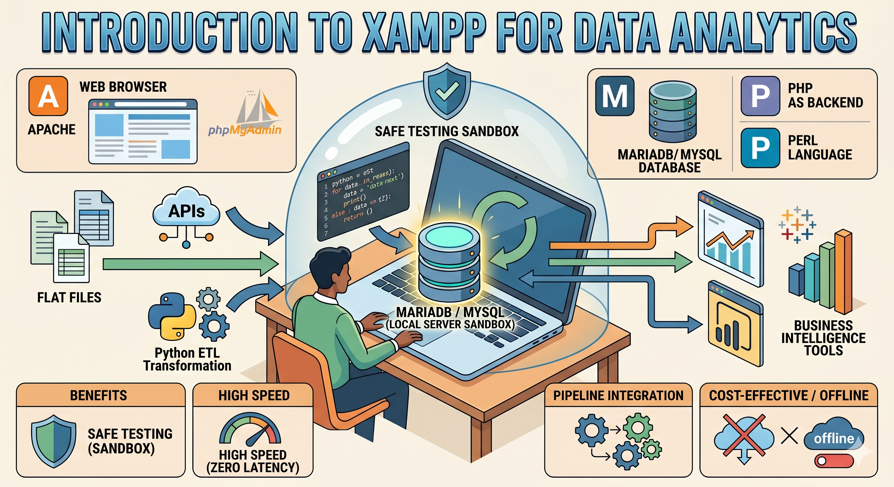

# Introduction to XAMPP for Data Analytics



## Introduction
As a Data Analyst or Business Intelligence professional, your workflow frequently involves extracting data from flat files or APIs, transforming it using tools like Python, and loading it into a structured database (ETL). While cloud databases are the standard in production environments, developing and testing your Python scripts against a live production database is risky, slow, and often restricted. 

This is where a local server environment becomes an essential part of your technical stack. XAMPP provides a seamless way to host a local database right on your machine, allowing you to build, test, and refine your data pipelines in a secure, isolated sandbox.

---

## Core Concepts: What is the XAMPP Stack?
XAMPP is a completely free, easy-to-install Apache distribution that provides a local web server and database environment. It is widely used by developers and analysts to simulate a live server locally. 

Let's break down the acronym:

* **X (Cross-Platform):** XAMPP is designed to work across multiple operating systems, including Windows, macOS, and Linux.
* **A (Apache):** The HTTP web server. While its primary purpose is to serve web pages, Data Analysts need Apache running to use graphical database management tools like phpMyAdmin, which run in the browser.
* **M (MariaDB / MySQL):** The Relational Database Management System (RDBMS). MariaDB is a community-developed, commercially supported fork of MySQL. For all practical Data Analytics and SQL querying purposes, MariaDB functions exactly like MySQL. **This is the most critical component for your analytics workflow.**
* **P (PHP):** A backend scripting language. You won't typically write PHP as a Data Analyst, but the Apache server uses it to run the phpMyAdmin interface.
* **P (Perl):** A high-level programming language included in the stack, though generally not used in modern data science workflows.

---

## Why is Local Database Hosting a Critical Skill?

You might wonder why a Data Analyst needs a server stack traditionally used by web developers. Mastering a local environment like XAMPP bridges the gap between basic spreadsheet analysis and advanced, enterprise-level data engineering.

### 1. Safe Testing Environment (The Sandbox)
When building complex ETL algorithms—such as phase-based healthcare data processing scripts—you need a place to test your code. Running an `UPDATE` or `DROP` statement accidentally on a live company database can be catastrophic. A local MySQL database allows you to make mistakes, drop tables, and reconstruct your schema without any real-world consequences.

### 2. Zero Latency and High Speed
Querying a remote database requires internet bandwidth and is subject to network latency. When dealing with millions of rows, this can slow down your development process. A local database processes queries instantaneously using your machine's hardware, drastically speeding up the testing of complex `JOIN`s, subqueries, and Python integrations.

### 3. End-to-End Pipeline Integration
To transition from a beginner to an advanced professional, you must know how different tools communicate. XAMPP allows you to practice connecting your primary IDEs (like VS Code or Jupyter Lab) directly to a database. You can test libraries like `mysql-connector-python` or `SQLAlchemy` locally, ensuring your data ingestion scripts work perfectly before deployment.

``` python
# Example of what we will achieve in upcoming modules:
# Connecting Python directly to your local XAMPP database
import mysql.connector

mydb = mysql.connector.connect(
  host="localhost",
  user="root",
  password="",
  database="analytics_sandbox"
)
```

### 4. Seamless BI Tool Connection
Business Intelligence tools like Tableau and Power BI are designed to ingest data from relational databases. Having a local database allows you to practice connecting these BI tools to a live SQL environment rather than relying solely on static `.csv` or `.xlsx` files. This mimics the exact workflow you will encounter in a corporate environment.

### 5. Cost-Effective and Offline
Cloud databases (like AWS RDS, Google Cloud SQL, or Azure) incur costs based on uptime and storage. XAMPP is 100% free and runs entirely offline. You can continue studying, building your portfolio, and querying databases even while traveling or without an internet connection.

---

## Summary
XAMPP transforms your personal computer into a powerful, offline data engineering environment. It is the crucial bridge that allows you to safely connect your Python scripts, your SQL queries, and your data visualization tools together in one cohesive workflow. 

---

**Next Step:** After initializing the local environment, let's manage schemas visually via [XAMPP Control Panel and phpMyAdmin](03.04.02-XAMPP_Control_Panel_and_phpMyAdmin.md).
**Skill Unlocked**: XAMPP, Local Server Administration
**Status:** Completed ✅