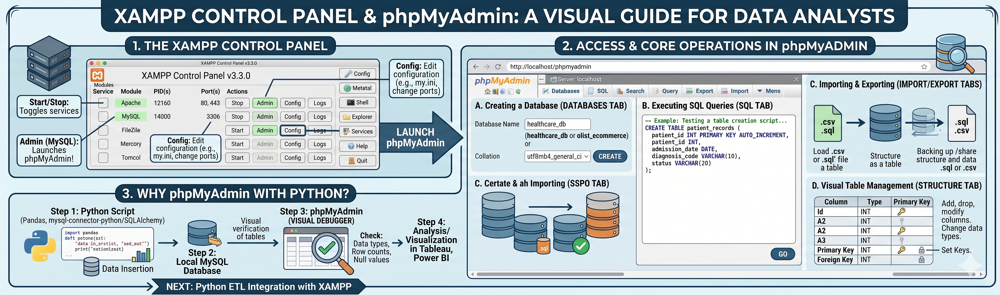

# XAMPP Control Panel and phpMyAdmin: A Visual Guide



## Introduction
Once XAMPP is installed, the Control Panel becomes your command center for local development. For data professionals, managing databases shouldn't always require command-line interfaces. XAMPP provides phpMyAdmin—a powerful graphical user interface (GUI) that allows you to build, manage, and query your MySQL databases visually. 

Understanding this environment is critical when developing robust data pipelines, such as healthcare ETL algorithms, allowing you to test SQL logic and database schemas safely before integrating them into your Python scripts.

---

## 1. The XAMPP Control Panel
The Control Panel is where you start and stop the individual services (modules) required for your local server environment.

### Key Modules for Data Analytics
* **Apache:** The web server. This must be running to access the phpMyAdmin interface in your browser. (Default Ports: 80, 443)
* **MySQL:** The relational database server. This must be running for Python, Tableau, or Power BI to connect to your local data. (Default Port: 3306)

### Core Actions
* **Start/Stop:** Toggles the modules on and off. Always ensure both Apache and MySQL are highlighted green.
* **Admin:** For MySQL, clicking 'Admin' automatically opens phpMyAdmin in your default browser.
* **Config:** Allows you to edit configuration files (like `my.ini` for MySQL) to change default ports or adjust memory limits if you are handling large datasets.
* **Logs:** Crucial for troubleshooting. If MySQL fails to start, the error log will specify why (often due to port conflicts).

---

## 2. Introduction to phpMyAdmin
phpMyAdmin is a web-based administration tool for MySQL and MariaDB. It completely removes the need to memorize complex command-line administration prompts.

**How to Access:**
1. Start **Apache** and **MySQL** in the Control Panel.
2. Click the **Admin** button next to MySQL, OR open your browser and navigate to: `http://localhost/phpmyadmin`


---

## 3. Core Database Operations for Data Analysts
While you will eventually automate these steps using Python, performing them manually in phpMyAdmin is the best way to validate your data architecture and practice your SQL syntax.

### A. Creating a Database
1. Navigate to the **Databases** tab on the top menu.
2. Enter a database name (e.g., `healthcare_db` or `olist_ecommerce`).
3. Set the collation (usually `utf8mb4_general_ci` for broad character support).
4. Click **Create**.

### B. Executing SQL Queries
You do not have to rely solely on the graphical buttons. phpMyAdmin includes an **SQL** tab where you can write and test raw SQL scripts. 
* This is highly useful for testing complex `JOIN` or `GROUP BY` clauses before pasting the query into a Jupyter Notebook or VS Code environment.

``` sql
-- Example: Testing a table creation script for an ETL pipeline
CREATE TABLE patient_records (
    patient_id INT PRIMARY KEY AUTO_INCREMENT,
    admission_date DATE,
    diagnosis_code VARCHAR(10),
    status VARCHAR(20)
);
```

### C. Importing and Exporting Data
Moving data between flat files and databases is a foundational task.
* **Import Tab:** Allows you to upload `.csv` or `.sql` files directly into a table. This is an excellent way to seed your database with initial data before running an analysis.
* **Export Tab:** Allows you to dump your database structure and data into a `.sql` or `.csv` file for backup, sharing, or version control on GitHub.

### D. Visual Table Management
Under the **Structure** tab of any table, you can visually:
* Add, drop, or modify columns without writing `ALTER TABLE` commands.
* Change data types (e.g., converting `VARCHAR` to `INT`).
* Set Primary and Foreign Keys to establish relational integrity across multiple tables.

---

## 4. Why Use phpMyAdmin Alongside Python?
When writing data extraction and redistribution algorithms, you are often manipulating data using Pandas and pushing it to MySQL using libraries like `mysql-connector-python` or `SQLAlchemy`. 

In this workflow, phpMyAdmin serves as your **visual debugger**. Instead of writing multiple `SELECT` statements in Python just to check if your data was inserted correctly, you can simply refresh phpMyAdmin and visually inspect the tables. This ensures the data types, row counts, and null values align perfectly with your expectations before you move on to visualization in Tableau or Power BI.

---

**Next Step:** After manipulating tables through the GUI, let's execute bulk insertions programmatically inside [Python ETL Integration with Local XAMPP MySQL](03.04.03-Python_ETL_Integration_with_XAMPP.md).
**Skill Unlocked**: phpMyAdmin, GUI Database Management
**Status:** Completed ✅