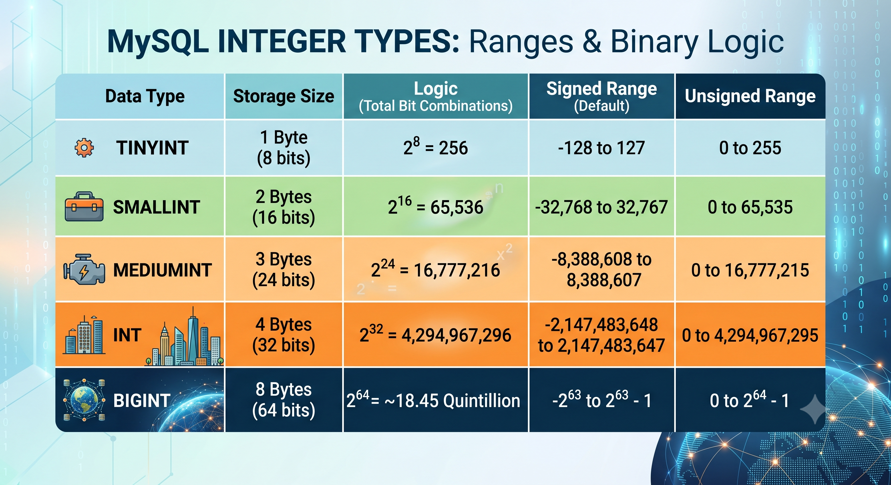

# Comprehensive Guide to MySQL Data Types

This document provides a complete list of all MySQL data types, including their syntax, definitions, and usage examples. MySQL data types are divided into six primary categories: Numeric, Date & Time, String, Spatial, JSON, and Vector.

---
### Important Architectural Notes
To stay aligned with modern database design patterns and the cleanup introduced in **MySQL 8.0.17+**, several legacy syntax behaviors have been officially **deprecated** and are slated for complete removal in future versions.

#### Quick Reference: Deprecation Summary Table

| **Feature / Syntax**           | **Affected Data Types**                             | **Status**       | **Reason For Deprecation**                                                                     |
| ------------------------------ | --------------------------------------------------- | ---------------- | ---------------------------------------------------------------------------------------------- |
| **Display Width `(M)`**        | `INT`, `TINYINT`, `SMALLINT`, `MEDIUMINT`, `BIGINT` | ❌ **Deprecated** | It was purely cosmetic padding; it did not limit or validate data ranges.                      |
| **`ZEROFILL` Attribute**       | All Numeric Types                                   | ❌ **Deprecated** | Presentation/formatting belongs in the application layer, not the database engine.             |
| **Precision Scale `(M,D)`**    | `FLOAT`, `DOUBLE`                                   | ❌ **Deprecated** | Hardware-locked sizes (`4`/`8` bytes) render it useless; it causes non-standard rounding bugs. |
| **Boolean Alias `TINYINT(1)`** | `TINYINT`                                           | **Retained**     | Kept explicitly for backward compatibility with popular application ORMs.                      |
| **String Length `(M)`**        | `CHAR`, `VARCHAR`                                   | **Permanent**    | Hard structural constraint defining physical/logical character capacity limits.                |
| **Exact Fixed Point `(M,D)`**  | `DECIMAL`                                           | **Permanent**    | Essential for financial calculations to prevent floating-point rounding errors.                |
#### Architectural Deep Dive

##### 1. Integer `(M)` — Visual Padding vs. Data Limits
- **The Illusion:** Writing `INT(11)` or `TINYINT(2)` never limited data length. It only told legacy CLI tools how many spaces to use for visual padding. An integer's real capacity and storage space are entirely locked by its type (e.g., `INT` is always 4 bytes, capping at 2.14 Billion).
- **The Exception:** `TINYINT(1)` is preserved solely because modern application ORMs explicitly watch for it to auto-convert database values into programmatic Booleans (`0` = `False`, `1` = `True`).

##### 2. `ZEROFILL` — Presentation Flaws & Silent Bugs
- **Wrong Layer:** Left-padding numbers with zeros (e.g., turning `42` into `0042`) is a front-end presentation concern. Modern architecture mandates formatting happen in your application code, not baked into the storage engine. 
- **The Side Effect:** `ZEROFILL` triggers a hidden behavior: it automatically forces the column to be `UNSIGNED`. This silently strips away negative number support, creating unexpected runtime bugs.

##### 3. Precision `(M,D)` — Exact Chunks vs. Hardware Locks
- **DECIMAL (Permanent):** Designed for flawless math (like financial currency). The engine uses `M` and `D` to dynamically calculate and allocate exact chunks of binary memory on your disk. `DECIMAL(5,2)` physically uses less storage than `DECIMAL(20,5)`.
- **FLOAT / DOUBLE (Deprecated):** Storage size is already hard-locked by system hardware (4 bytes for float, 8 bytes for double). Forcing `(M,D)` onto approximate types does not save space; instead, it causes non-standard rounding that masks genuine floating-point calculation errors. 

##### 4. String `(M)` — The Hard Physical Boundary
- **The Real Wall:** Unlike numeric types, the `(M)` in `CHAR(M)` and `VARCHAR(M)` is an ANSI-standard structural constraint. Declaring `VARCHAR(100)` builds a strict data boundary. Attempting to pass a 101st character triggers a hard engine rejection to protect data integrity.

---
## 🔢 Numeric Data Types

* **TINYINT**
    * **Syntax:** `TINYINT[(M)] [UNSIGNED] [ZEROFILL]`
    * **Definition:** A very small integer. Signed range is -128 to 127. Unsigned range is 0 to 255 (**1 byte**) (2^8 = 256).
    * **Example:** `age TINYINT UNSIGNED;`
* **SMALLINT**
    * **Syntax:** `SMALLINT[(M)] [UNSIGNED] [ZEROFILL]`
    * **Definition:** A small integer. Signed range is -32,768 to 32,767. Unsigned range is 0 to 65,535 (**2 bytes**) (2^16 = 65,536).
    * **Example:** `employee_count SMALLINT;`
* **MEDIUMINT**
    * **Syntax:** `MEDIUMINT[(M)] [UNSIGNED] [ZEROFILL]`
    * **Definition:** A medium-sized integer. Signed range is -8,388,608 to 8,388,607. Unsigned range is 0 to 16,777,215 (**3 bytes**) (2^24 = 16,777,216).
    * **Example:** `city_population MEDIUMINT UNSIGNED;`
* **INT / INTEGER**
    * **Syntax:** `INT[(M)] [UNSIGNED] [ZEROFILL]`
    * **Definition:** A standard integer. Signed range is -2,147,483,648 to 2,147,483,647. Unsigned range is 0 to 4,294,967,295 (**4 bytes**) (2^32 = 4,294,967,296).
    * **Example:** `user_id INT AUTO_INCREMENT;`
* **BIGINT**
    * **Syntax:** `BIGINT[(M)] [UNSIGNED] [ZEROFILL]`
    * **Definition:** A large integer. Signed range is -2^63 to 2^63-1. Unsigned range is 0 to 2^64-1 (**8 bytes**) (2^64 = 18,446,744,073,709,551,616) (approximately 18.45 quintillion).
    * **Example:** `total_website_views BIGINT;`

* **DECIMAL / NUMERIC**
    * **Syntax:** `DECIMAL(M,D) [UNSIGNED] [ZEROFILL]`
    * **Definition:** Fixed-point exact decimal numbers. `M` is the total number of digits (precision) and `D` is the number of digits after the decimal point (scale).
    * **Best Used For:** Money, currency, accounting, billing, and strict scientific counts.
    * **Example:** `product_price DECIMAL(10, 2);`
* **FLOAT**
    * **Syntax:** `FLOAT[(M,D)] [UNSIGNED] [ZEROFILL]`
    * **Definition:** A small (single-precision) floating-point number.
    * **Best Used For:** Graphic coordinates, audio/video rendering, machine learning embeddings, and massive statistical datasets.
    * **Example:** `temperature FLOAT;`
* **DOUBLE / REAL**
    * **Syntax:** `DOUBLE[(M,D)] [UNSIGNED] [ZEROFILL]`
    * **Definition:** A normal-size (double-precision) floating-point number.
    * **Example:** `exact_measurement DOUBLE;`

> 💡 **The Golden Rule:** If you are dealing with money, use `DECIMAL`. If you are dealing with physics or massive scientific datasets where performance matters more than a micro-decimal error, use `FLOAT` or `DOUBLE`.
> 
> 🔬 **The Microscopic Drift:**
> *If you store the number `10` as a `FLOAT`, it will be exactly `10`. The issue only starts when you introduce fractions and decimals (like `10.25` or `0.1`).
> Because computers map numbers to base-2 binary fractions, a number like `0.1` cannot be cleanly represented. The hardware forces `FLOAT` to save the closest possible approximation. Behind the scenes, the database sees your `0.1` more like `0.100000001490116119384765625`.
> For a single calculation, that tiny difference at the end doesn't matter. But during complex calculations, those microscopic discrepancies compound.

* **BIT**
    * **Syntax:** `BIT[(M)]`
    * **Definition:** A bit-value type for storing bit fields. `M` indicates the number of bits per value (1 to 64).
    * **Example:** `active_flags BIT(8);`
* **BOOLEAN / BOOL**
    * **Syntax:** `BOOLEAN`
    * **Definition:** Synonyms for `TINYINT(1)`. A value of zero is considered false. Non-zero values are considered true. It takes up **1 byte** (8 bits) of storage.
    * **Example:** `is_published BOOLEAN;`

> 📝 **Note on BIT vs BOOLEAN:** Using `BOOLEAN` is highly intuitive as it maps directly to standard application-level `True/False` values. Using `BIT` is more complex because it can be leveraged for **Bitmasking** (storing multiple flags in a single column) which requires bitwise calculations (`&`, `|`) to query. While `BIT` is significantly more **storage-efficient** for multi-flag datasets, `BOOLEAN` is generally preferred for simple, single-purpose flags due to its native compatibility with programming languages and ORMs.

---

## 📅 Date and Time Data Types

* **DATE**
    * **Syntax:** `DATE`
    * **Definition:** A date value in `YYYY-MM-DD` format. Supported range is '1000-01-01' to '9999-12-31'.
    * **Example:** `birth_date DATE;`
* **TIME**
    * **Syntax:** `TIME[(fsp)]`
    * **Definition:** A time value in `HH:MM:SS` format. Supported range is '-838:59:59' to '838:59:59'.
    * **Example:** `shift_start TIME;`
* **DATETIME**
    * **Syntax:** `DATETIME[(fsp)]`
    * **Definition:** A combined date and time in `YYYY-MM-DD HH:MM:SS` format. Range is '1000-01-01 00:00:00' to '9999-12-31 23:59:59'.
    * **Example:** `account_created DATETIME;`
* **TIMESTAMP**
    * **Syntax:** `TIMESTAMP[(fsp)]`
    * **Definition:** An epoch-based timestamp. It automatically converts times to UTC for storage, and from UTC to the current time zone for retrieval.
    * **Example:** `last_login TIMESTAMP DEFAULT CURRENT_TIMESTAMP;`
* **YEAR**
    * **Syntax:** `YEAR[(4)]`
    * **Definition:** A year value in 4-digit format. Range is 1901 to 2155, and 0000.
    * **Example:** `graduation_year YEAR;`

#### **`fsp`** stands for **Fractional Seconds Precision**.
- **The Range:** The value of `fsp` must be an integer from **`0` to `6`**. 
- **The Default:** If you omit it and just write `DATETIME` or `TIMESTAMP`, the default `fsp` is **`0`** (meaning no fractional seconds are tracked at all).
- **Maximum Precision:** A value of `6` represents **microseconds** (one-millionth of a second). MySQL does not natively support nanoseconds (`fsp` of 9) in these standard types.

##### Visual Example

| **Data Type Definition**        | **How it Stores/Displays the Time** | **Precision Level** |
| ------------------------------- | ----------------------------------- | ------------------- |
| `DATETIME` _(or `DATETIME(0)`)_ | `2026-06-13 12:30:45`               | Whole Seconds       |
| `DATETIME(3)`                   | `2026-06-13 12:30:45.**123**`       | Milliseconds        |
| `DATETIME(6)`                   | `2026-06-13 12:30:45.**123456**`    | Microseconds        |
##### Two Things to Keep in Mind

1. **Automatic Rounding:** If you try to insert a timestamp with more fractional digits than your `fsp` allows, MySQL will **round** the value rather than truncating it.
2. **Storage Impact:** While a baseline `DATETIME` takes up 5 bytes of storage, adding an `fsp` will increase the required storage. 

**When to use it:** Leave it blank (`0`) for basic user facing data like `created_at` or `birth_date`. Use `(3)` or `(6)` for high-frequency financial transactions, logging systems, or API event tracking where actions happen multiple times within the exact same second.

---

## 🔤 String Data Types

* **CHAR**
    * **Syntax:** `CHAR(M)`
    * **Definition:** A fixed-length non-binary character string. `M` represents the column length in characters (0 to 255).
    * **Example:** `country_code CHAR(2);`
* **VARCHAR**
    * **Syntax:** `VARCHAR(M)`
    * **Definition:** A variable-length non-binary character string. `M` represents the maximum column length in characters (up to 65,535).
    * **Example:** `username VARCHAR(50);`
* **TINYTEXT**
    * **Syntax:** `TINYTEXT`
    * **Definition:** A very small non-binary string with a maximum length of 255 characters.
    * **Example:** `short_bio TINYTEXT;`
* **TEXT**
    * **Syntax:** `TEXT`
    * **Definition:** A standard non-binary string with a maximum length of 65,535 characters.
    * **Example:** `article_content TEXT;`
* **MEDIUMTEXT**
    * **Syntax:** `MEDIUMTEXT`
    * **Definition:** A medium non-binary string with a maximum length of 16,777,215 characters.
    * **Example:** `book_chapter MEDIUMTEXT;`
* **LONGTEXT**
    * **Syntax:** `LONGTEXT`
    * **Definition:** A large non-binary string with a maximum length of 4,294,967,295 characters (4GB).
    * **Example:** `entire_book LONGTEXT;`
* **BINARY**
    * **Syntax:** `BINARY(M)`
    * **Definition:** Similar to `CHAR`, but stores binary byte strings rather than non-binary character strings. Fixed-length.
    * **Example:** `mac_address BINARY(6);`
* **VARBINARY**
    * **Syntax:** `VARBINARY(M)`
    * **Definition:** Similar to `VARCHAR`, but stores variable-length binary byte strings.
    * **Example:** `ipv6_address VARBINARY(16);`
* **TINYBLOB**
    * **Syntax:** `TINYBLOB`
    * **Definition:** A small Binary Large Object (max 255 bytes).
    * **Example:** `small_icon TINYBLOB;`
* **BLOB**
    * **Syntax:** `BLOB`
    * **Definition:** A standard Binary Large Object (max 65,535 bytes).
    * **Example:** `image_data BLOB;`
* **MEDIUMBLOB**
    * **Syntax:** `MEDIUMBLOB`
    * **Definition:** A medium Binary Large Object (max 16MB).
    * **Example:** `audio_clip MEDIUMBLOB;`
* **LONGBLOB**
    * **Syntax:** `LONGBLOB`
    * **Definition:** A large Binary Large Object (max 4GB).
    * **Example:** `video_file LONGBLOB;`
* **ENUM**
    * **Syntax:** `ENUM('value1', 'value2', ...)`
    * **Definition:** An enumeration. A string object that can have only one value, chosen from the list of permitted values.
    * **Example:** `order_status ENUM('pending', 'shipped', 'delivered');`
* **SET**
    * **Syntax:** `SET('value1', 'value2', ...)`
    * **Definition:** A string object that can have zero or more values, chosen from a list of permitted values.
    * **Example:** `user_roles SET('admin', 'editor', 'viewer');`

---

## 🌐 Spatial Data Types

* **GEOMETRY**
    * **Syntax:** `GEOMETRY`
    * **Definition:** A base type representing any spatial value.
    * **Example:** `location GEOMETRY;`
* **POINT**
    * **Syntax:** `POINT`
    * **Definition:** A point geometry representing a single X, Y coordinate pair.
    * **Example:** `store_coordinate POINT;`
* **LINESTRING**
    * **Syntax:** `LINESTRING`
    * **Definition:** A curve geometry with linear interpolation between points.
    * **Example:** `delivery_route LINESTRING;`
* **POLYGON**
    * **Syntax:** `POLYGON`
    * **Definition:** A multisided planar geometry defined by one exterior boundary and zero or more interior boundaries.
    * **Example:** `service_area POLYGON;`
* **MULTIPOINT**
    * **Syntax:** `MULTIPOINT`
    * **Definition:** A collection of points.
    * **Example:** `bus_stops MULTIPOINT;`
* **MULTILINESTRING**
    * **Syntax:** `MULTILINESTRING`
    * **Definition:** A collection of line strings.
    * **Example:** `river_network MULTILINESTRING;`
* **MULTIPOLYGON**
    * **Syntax:** `MULTIPOLYGON`
    * **Definition:** A collection of polygons.
    * **Example:** `island_group MULTIPOLYGON;`
* **GEOMETRYCOLLECTION**
    * **Syntax:** `GEOMETRYCOLLECTION`
    * **Definition:** A collection of geometry objects of any type.
    * **Example:** `complex_shape GEOMETRYCOLLECTION;`

---

## 📋 JSON Data Type

* **JSON**
    * **Syntax:** `JSON`
    * **Definition:** A native JSON data type that automatically validates JSON formatting and permits optimized lookups and structural extraction.
    * **Example:** `user_preferences JSON;`

---

## 📐 Vector Data Type

* **VECTOR**
    * **Syntax:** `VECTOR(N)`
    * **Definition:** A native data type used for storing high-dimensional vector embeddings, commonly leveraged in AI and machine learning. `N` is the number of dimensions.
    * **Example:** `image_embedding VECTOR(1536);`