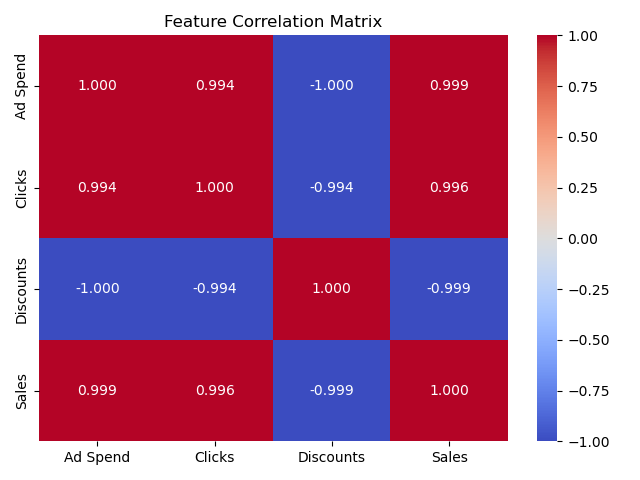

# NumPy Pearson Correlation Coefficient (`np.corrcoef`)

`np.corrcoef()` computes the **Pearson correlation matrix**, measuring the linear relationship between numerical variables ($r \in [-1, +1]$).

---
## 1. Core Mechanics & Output Structure

Passing two arrays produces a symmetric $2 \times 2$ correlation matrix:
```python
import numpy as np

x = np.array([10, 20, 30, 40, 50])
y = np.array([15, 25, 32, 42, 58])

matrix = np.corrcoef(x, y)
print(matrix)
# [[1.         0.99625346]
#  [0.99625346 1.        ]]

# Extract the direct scalar value between x and y
r_xy = matrix[0, 1]
print("Pearson r:", round(r_xy, 4))  # Output: 0.9963
```

- **Diagonal (`matrix[0,0]`, `matrix[1,1]`):** Self-correlation ($r = 1.0$).
- **Off-Diagonal (`matrix[0,1]`, `matrix[1,0]`):** Symmetrical cross-variable correlation $r_{xy}$.

---
## 2. Mathematical Definition & Manual Verification

$$r = \frac{\sum (x_i - \bar{x})(y_i - \bar{y})}{\sqrt{\sum (x_i - \bar{x})^2 \sum (y_i - \bar{y})^2}}$$
```python
import numpy as np

x = np.array([10, 20, 30, 40, 50])
y = np.array([15, 25, 32, 42, 58])

# Manual verification
dev_x, dev_y = x - np.mean(x), y - np.mean(y)
r_manual = np.sum(dev_x * dev_y) / np.sqrt(np.sum(dev_x**2) * np.sum(dev_y**2))

print("Manual Computation:", r_manual)
```

---
## 3. Multi-Variable Analysis (Tabular Data)

When evaluating feature sets in tabular data, use `rowvar=False` so columns are treated as features.

```python
import numpy as np
import pandas as pd
import seaborn as sns
import matplotlib.pyplot as plt

# Generate multi-feature matrix (5 rows, 4 features)
data = np.column_stack([
    [100, 200, 300, 400, 500],  # Ad Spend
    [150, 260, 310, 420, 530],  # Web Clicks
    [ 25,  20,  15,  10,   5],  # Discounts
    [ 10,  25,  35,  48,  60]   # Sales
])

# Compute 4x4 Correlation Matrix (rowvar=False processes columns as features)
corr_matrix = np.corrcoef(data, rowvar=False)

# Render readable Pandas & Seaborn Heatmap
features = ['Ad Spend', 'Clicks', 'Discounts', 'Sales']
df_corr = pd.DataFrame(corr_matrix, index=features, columns=features)

sns.heatmap(df_corr, annot=True, cmap="coolwarm", vmin=-1, vmax=1, fmt=".3f")
plt.title("Feature Correlation Matrix")
plt.tight_layout()
plt.show()
```


---
## 4. Key Data Analytics Interpretations

- **$+1.0$:** Perfect positive linear trend (as $X$ increases, $Y$ increases).
- **$0.0$:** No linear association.
- **$-1.0$:** Perfect inverse linear trend.
- **Multicollinearity Prevention:** Identifying features with $r > 0.85$ allows dropping redundant inputs before modeling.

> **Caution:** Pearson correlation measures **linear relationships only**. Non-linear curves (e.g., $y = x^2$) may result in $r \approx 0$.
